# Simple Bible 📖

**God's Word, in the language of your heart.**

Simple Bible is a calm, offline-first Bible app for everyday reading. Read and
search Scripture, explore it by topic, pause for a daily reflection and keep
your own notes. New translations can be added at any time from the version
library, without an app update.

Built with Flutter by **CodeKraft**.

> Coming soon to Google Play.

## Features 🚀

- **Reader:**
  - Chapter-by-chapter reading with smooth chapter navigation.
  - Go to any reference.
  - Highlight verses, or select several to copy, favourite or note.
- **Many translations:**
  - King James Version is built in.
  - The version library downloads more translations as they're published.
  - Pick one version and it's used across the reader, topics and search.
- **Topics:** explore Scripture through more than 160 topics, from *Faith* to
  *Forgiveness*.
- **Verse of the Day and daily reflections:**
  - Each day brings a short reflection, a question, a step to take and a
    prayer.
  - A history of past reflections, filterable by topic.
- **Search:**
  - Jump straight to a reference such as `john 3:16`.
  - Search words or exact phrases across verses, your notes and topics.
  - Filter by testament or book, with an optional whole-word match.
- **Notes:** a note editor with undo and redo, linked to the verses you write
  about.
- **Favourites and reading history:** pick up right where you left off.
- **Light and dark themes**, or follow the system setting.
- **Private by design:**
  - No accounts, no ads and no tracking.
  - Your notes and history never leave your device.

## Screenshots 📸

| Light Theme | Dark Theme |
|-------------|------------|
| 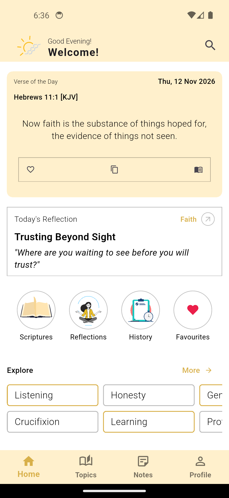 | 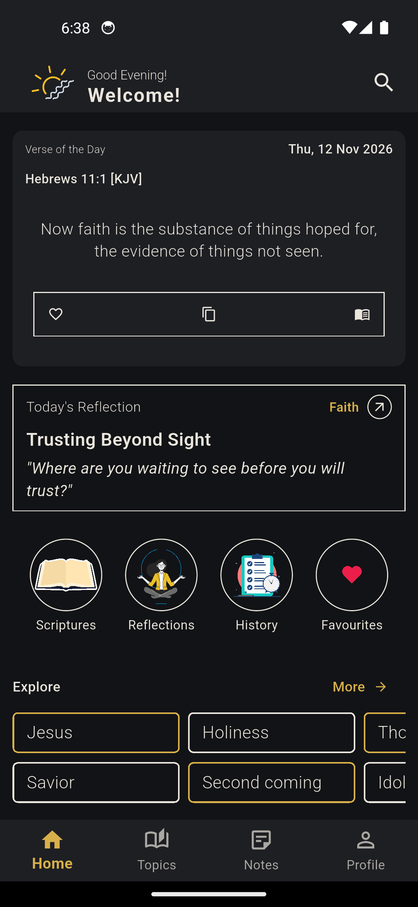 |
| 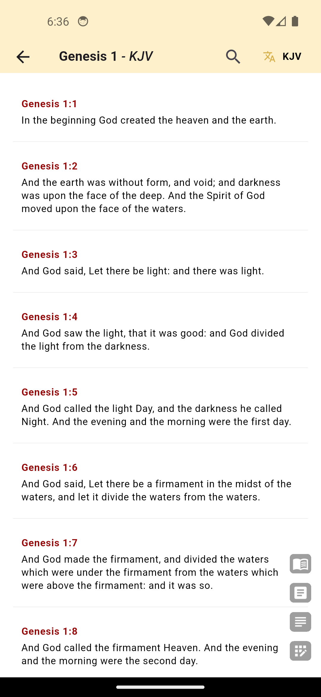 | 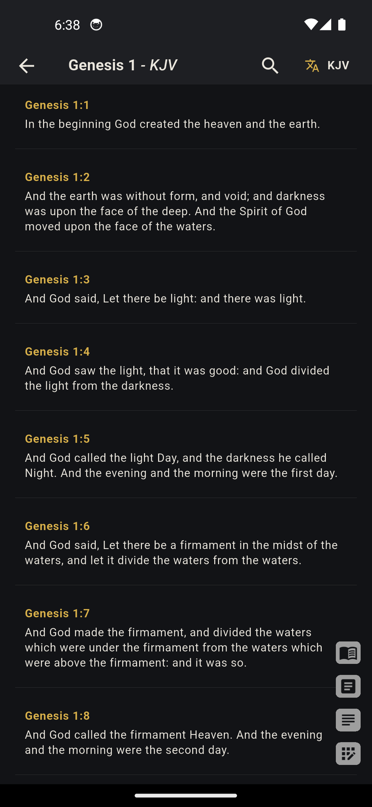 |
| 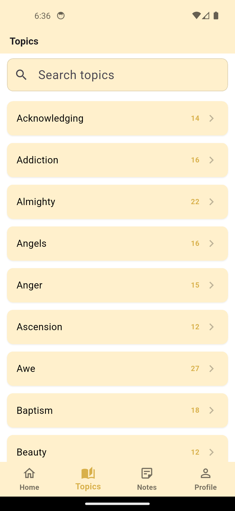 | 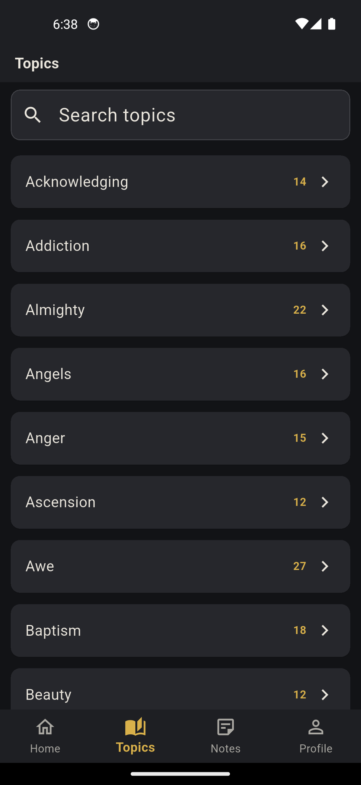 |
| 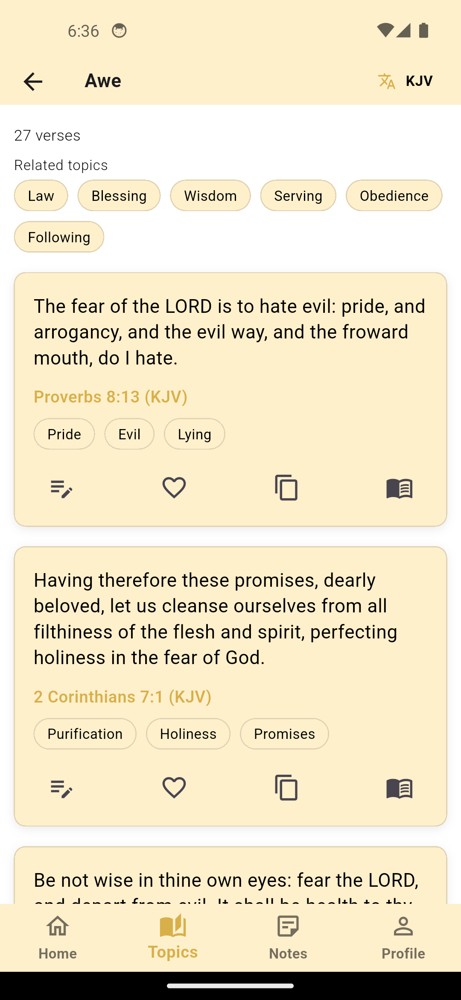 | 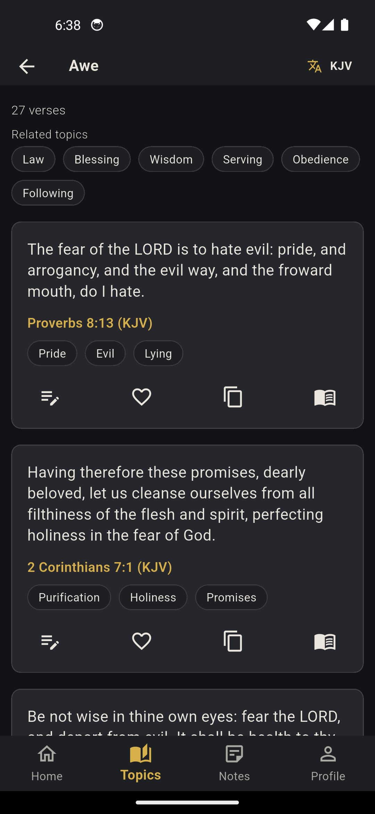 |
| 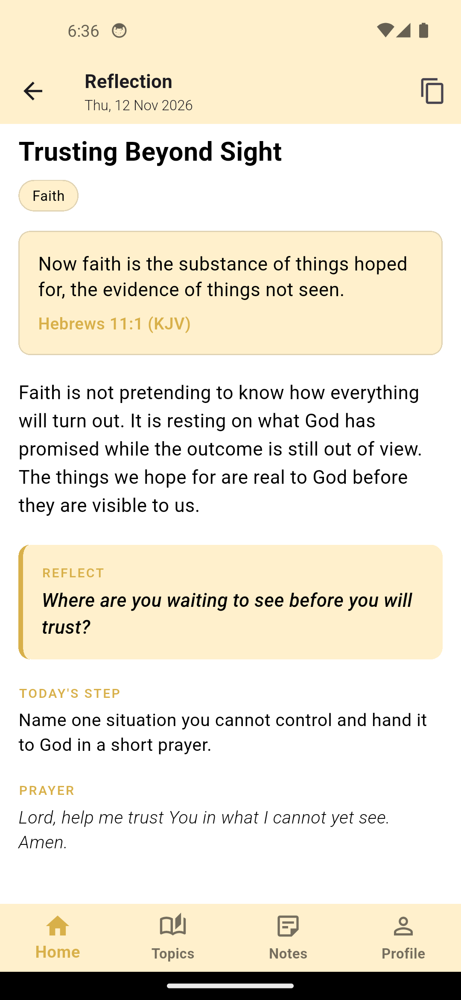 | 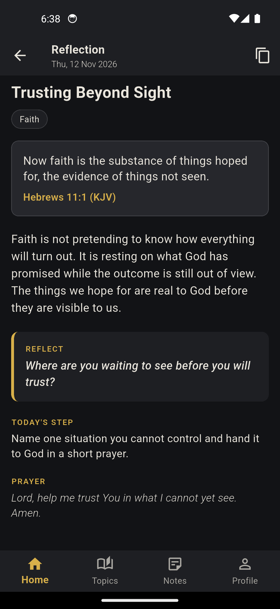 |
| 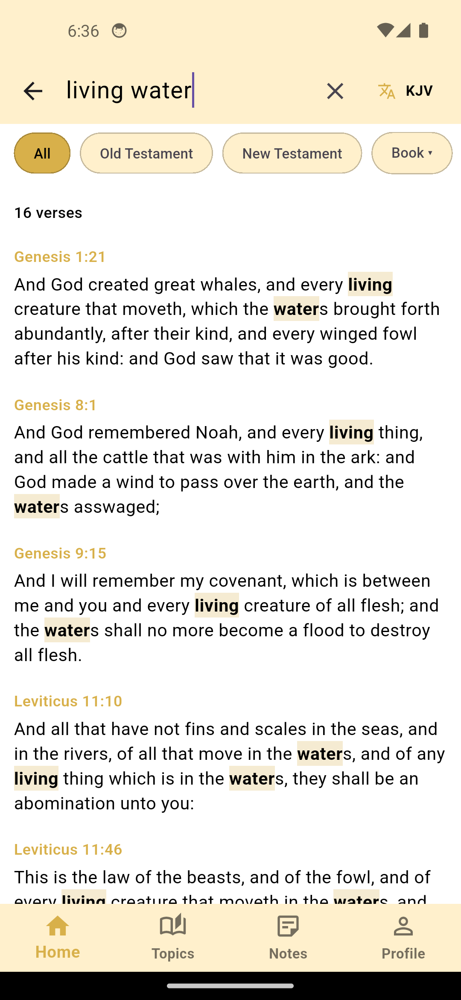 | 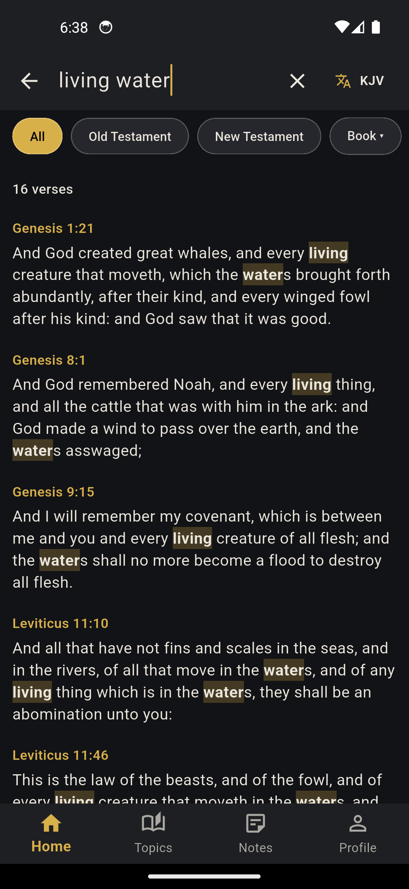 |
| 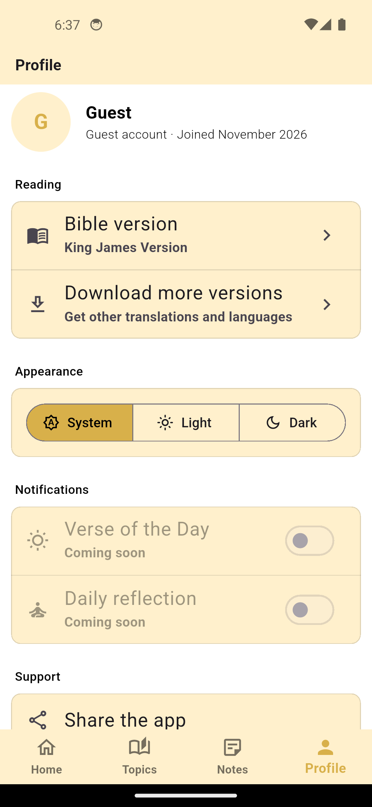 | 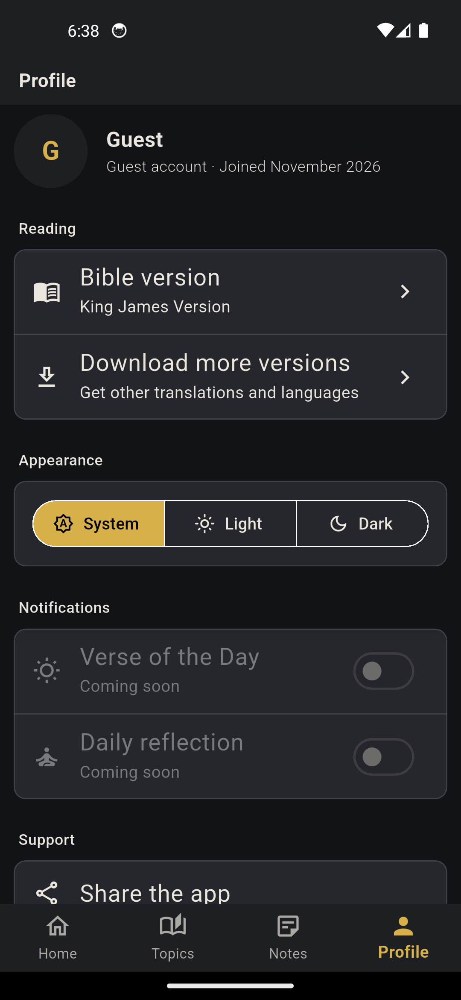 |

## Getting started 🛠️

Requirements:
- Flutter 3.44 or later (Dart 3.6+)
- Android Studio or VS Code with the Flutter plugin
- An Android device or emulator. The app is Android-only for now.

```sh
flutter pub get
dart run build_runner build --delete-conflicting-outputs   # ObjectBox code
flutter run
```

```sh
flutter analyze
flutter test
```

**Project layout:** each feature in `lib/` (`bible_reader`, `topics`,
`reflections`, `search`, `notes`, `version_store`, …) is split into `domain`,
`data`, `application` and `presentation` layers. State is managed with
Riverpod and stored locally with ObjectBox.

**Releases:** see [docs/RELEASING.md](docs/RELEASING.md) for signing,
versioning and publishing, and [CHANGELOG.md](CHANGELOG.md) for what has
changed.

## Future development 🌱

Ideas on the roadmap, in no particular order:

- **Internationalisation:** translate the app's interface (not just the
  Scripture) into Twi and other languages, using Flutter's `gen_l10n`. This
  would start with moving hard-coded strings into ARB files.
- **Notifications:** daily reminders for the Verse of the Day and the daily
  reflection. The Profile screen already has the toggles in place.
- **More translations:** keep growing the version library, with clear licence
  information for each translation.
- **Back up and export notes:** to a file or cloud storage, so notes survive a
  new phone.
- **Reading text size** and other reading preferences.
- **Clear data:** options to clear reading history and recent searches.
- **Report a text error:** a pre-filled report with the version and verse, to
  fix typos in translations quickly.
- **AI-assisted reflections:** grow the reflections library with LLM-drafted
  content, always reviewed by a person before it ships. A prompt template is in
  [docs/reflection_prompt_template.md](docs/reflection_prompt_template.md).
- **CodeKraft website** with app news and support.
- **iOS** release.

Have an idea? Email [c0d3.kraft@gmail.com](mailto:c0d3.kraft@gmail.com).

## Acknowledgements 🙏

- Topic collections are based on the topical index at
  [DailyVerses.net](https://dailyverses.net).
- Bible translations belong to their respective rights holders.
- Animations from the [LottieFiles](https://lottiefiles.com) community,
  including [Meteocons](https://github.com/basmilius/weather-icons) by Bas
  Milius.

## Team 🤝

Simple Bible is made by **CodeKraft**:
- [Jeffrey Boahen 🔥](https://github.com/yellow-Flickr)
- [Collins Brobbey 🤓](https://github.com/Qweku)

## Licence

© 2026 CodeKraft. All rights reserved. See [LICENSE](LICENSE).
The [privacy policy](https://yellow-flickr.github.io/simple-bible-catalogue/privacy-policy/)
and [terms of use](https://yellow-flickr.github.io/simple-bible-catalogue/terms-of-use/)
apply to the app.
